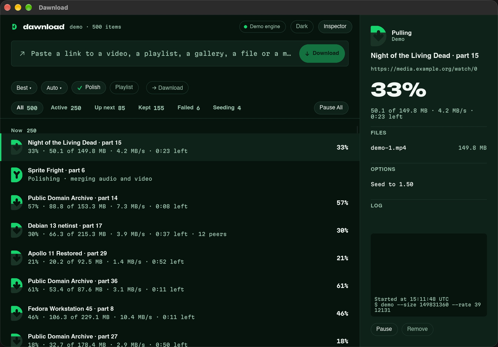
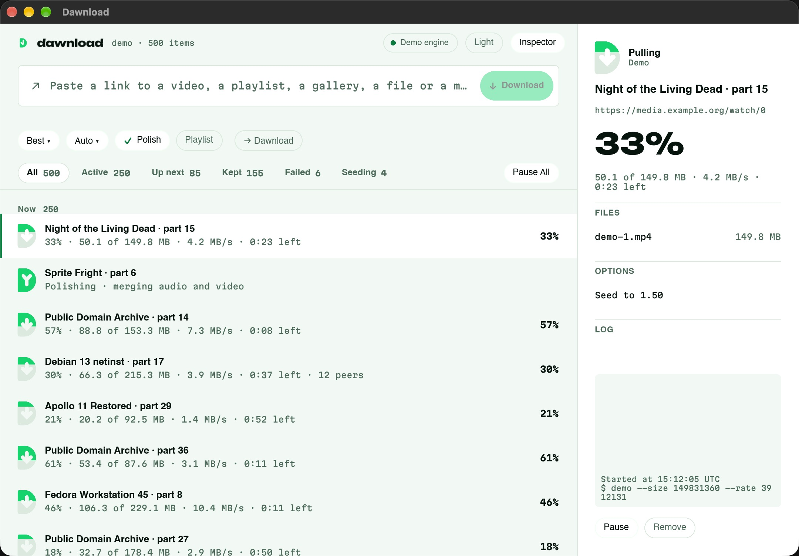

# 0008 · Slint prototype: measured, Slint confirmed

Status: Accepted, final (2026-11-10). The owner confirmed Slint, with its royalty-free licence (ADR 0009). Windows and Linux measurements are still to be recorded.

## Context

ADR 0001 chose Slint provided a prototype holds up. Targets set beforehand: about **100 MB with
the window open and idle**, and **smooth scrolling** through a long list that is updating, on the
real update path (core → snapshot/diffs → UI), not a static mock-up.

## What was built

`crates/dawnload-ui` (`dawnload-app`): the main window from DESIGN.md (header with tools pill;
paste field with the detection line and chips; filter tabs with counts and the queue control;
the grouped list with section headers; Cut D state glyphs drawn from the brand geometry for
Queued, Pulling, Polishing, Kept, Failed, Paused and Seeding; the inspector with the big percent
in Unbounded, swarm, files, options, log and actions). Brand tokens, bundled OFL fonts, light and
dark (follows the system; the header toggles it). Keyboard: ↑/↓ select, Return runs the primary
action, Delete removes, Esc clears, ⌘L/Ctrl+L focuses the paste field.

It runs the real core with the demo engine: 500 items (a tenth are magnets that pull and then
seed), up to 250 running at once, each ticking 5 times a second, with finished items cleared and
replaced every 2 s so the list keeps moving. `dawnload-app --real` runs the same window on the real
core and tools.

A bridge task on the core's runtime keeps a `Mirror`, builds the rows for the current filter,
and diffs them against what's on screen; the UI thread only receives the changed rows
(`set_row_data`, ~1,400 per second here) and never resets the list, so the virtualized
`ListView` keeps its scroll position and only redraws visible rows.

## Measurements (macOS)

MacBook Pro, Apple Silicon (arm64), macOS 27.2, release build, Slint 1.18.1 with the winit backend
and FemtoVG (OpenGL) renderer. `Scripts/measure-ui.sh`: 8 s warm-up, then 30 s per scenario.
CPU is the whole process (UI, core and the demo engine's 500 jobs), as a share of one core.
Footprint is macOS's `phys_footprint` (Activity Monitor's "Memory").

| Scenario | RSS avg | Footprint | CPU | Frames/s | Rows patched/s |
|---|---|---|---|---|---|
| Idle, empty list | 103.3 MB | 96.0 MB | 0.1% | 0 | 0 |
| Idle, 500 items updating | 108.6 MB | 113.0 MB | 5.0% | 8 | 1,415 |
| Scrolling, 500 items updating | 110.2 MB | 124.0 MB | 13.6% | 66 | 1,401 |
| Scrolling, 500 items, every row's fill eased | 109.8 MB | 124.0 MB | 15.7% | 93 | 1,401 |

- Scrolling is driven at 16 ms per step; 66 frames/s means every step was drawn (no dropped
  frames at the driver's rate). With eased row fills the renderer reached 93 frames/s.
- Idle with nothing happening, the window draws nothing and uses no measurable CPU.
- The software renderer (`SLINT_BACKEND=winit-software`) idles at a 70 MB footprint (143 MB RSS):
  an option for machines without working GPU drivers.
- Binaries (release, arm64): `dawnload-app` 22.9 MB, `dawnload` 9.6 MB.

For comparison (not measured here): a Tauri window is a system webview process tree, typically
150–300 MB on Windows with WebView2 before any app state, and a list of 500 updating DOM rows
needs its own virtualization.

## Decision

**Slint is confirmed** for the full UI (phase 3), and the owner made this final on 2026-11-10. It meets the idle target (96 MB footprint,
~0% CPU) and scrolls 500 updating rows at full rate for ~14% of one core, on the real update
path. Tauri stays the documented fallback.

Two choices follow from the numbers:
- **Row fills step, the inspector eases.** Easing every row's fill kept the window redrawing at
  ~93 frames/s for ~2 points more CPU and no visible gain at 32 px; only the inspector's 44 px
  glyph eases. (DESIGN.md's 200 ms easing still holds where it's seen up close.)
- **Rows are patched, never reset.** The first version reset the list 4 times a second; patching
  only changed rows is what keeps CPU flat as the list grows.

## Still to prove (phase 3 gates)

- **Windows and Linux numbers.** Run `Scripts/measure-ui.ps1` on Windows 11 and
  `Scripts/measure-ui.sh` on a Linux desktop (X11 and Wayland). Same targets. Not run yet.
- Accessibility with real screen readers (Narrator, Orca, VoiceOver): rows set an accessible
  label, but nothing has been tested with assistive technology.
- IME and paste of non-Latin text in the paste field; HiDPI on Windows at 150%/175%.
- The pieces Slint doesn't hand us: tray icon behaviour per OS, drag and drop of links and
  `.torrent` files, native menus on macOS, notifications.
- Not in the prototype: chip menus (chips cycle instead), drag to reorder, context menus, the
  loader animation, Reduce Motion, Settings and first run.
