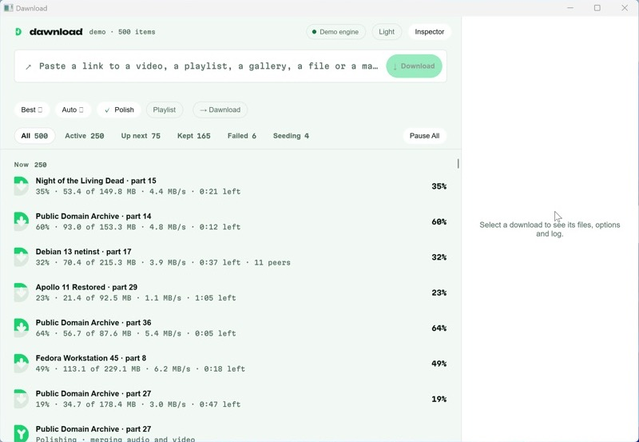
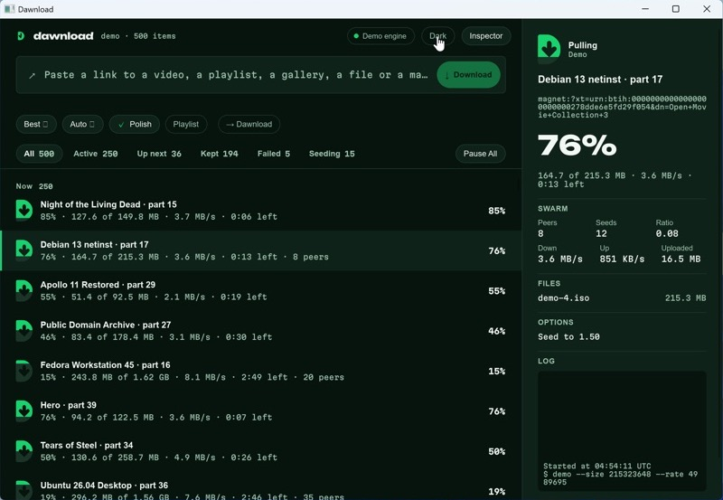
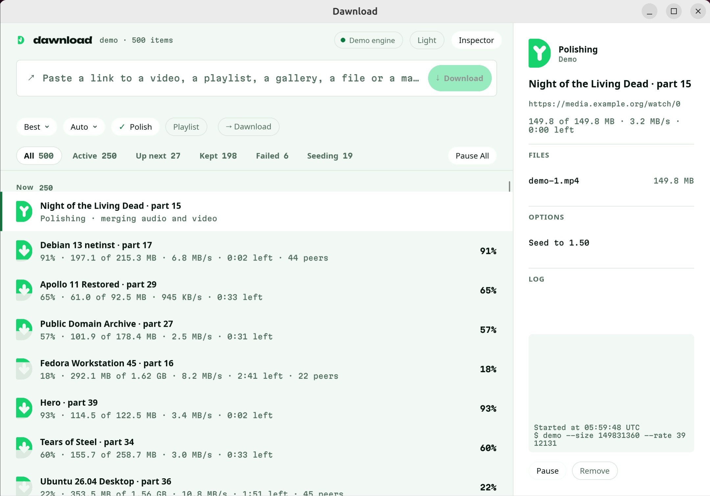
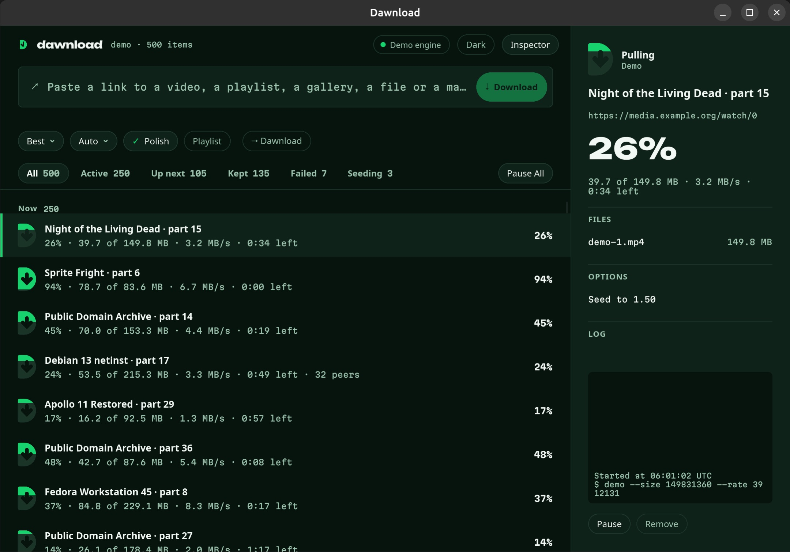

# 0008 · Slint prototype: measured, Slint confirmed

Status: Accepted, final (2026-11-10). The owner confirmed Slint, with its royalty-free licence (ADR 0009). Windows and Linux (Ubuntu 24.04 on ARM) measured on 2026-11-12 (below).

## Context

ADR 0001 chose Slint provided a prototype holds up. Targets set beforehand: about **100 MB with
the window open and idle**, and **smooth scrolling** through a long list that is updating, on the
real update path (core → snapshot/diffs → UI), not a static mock-up.

## What was built

`crates/dawnload-ui` (`dawnload-app`): the main window from DESIGN.md (header with tools pill;
paste field with the detection line and chips; filter tabs with counts and the queue control;
the grouped list with section headers; Cut D state glyphs drawn from the brand geometry for
Queued, Pulling, Polishing, Kept, Failed, Paused and Seeding; the inspector with the big percent
in Unbounded, swarm, files, options, log and actions). Brand tokens, bundled OFL fonts, light and
dark (follows the system; the header toggles it). Keyboard: ↑/↓ select, Return runs the primary
action, Delete removes, Esc clears, ⌘L/Ctrl+L focuses the paste field.

It runs the real core with the demo engine: 500 items (a tenth are magnets that pull and then
seed), up to 250 running at once, each ticking 5 times a second, with finished items cleared and
replaced every 2 s so the list keeps moving. `dawnload-app --real` runs the same window on the real
core and tools.

A bridge task on the core's runtime keeps a `Mirror`, builds the rows for the current filter,
and diffs them against what's on screen; the UI thread only receives the changed rows
(`set_row_data`, ~1,400 per second here) and never resets the list, so the virtualized
`ListView` keeps its scroll position and only redraws visible rows.

## Measurements (macOS)

MacBook Pro, Apple Silicon (arm64), macOS 27.2, release build, Slint 1.18.1 with the winit backend
and FemtoVG (OpenGL) renderer. `Scripts/measure-ui.sh`: 8 s warm-up, then 30 s per scenario.
CPU is the whole process (UI, core and the demo engine's 500 jobs), as a share of one core.
Footprint is macOS's `phys_footprint` (Activity Monitor's "Memory").

| Scenario | RSS avg | Footprint | CPU | Frames/s | Rows patched/s |
|---|---|---|---|---|---|
| Idle, empty list | 103.3 MB | 96.0 MB | 0.1% | 0 | 0 |
| Idle, 500 items updating | 108.6 MB | 113.0 MB | 5.0% | 8 | 1,415 |
| Scrolling, 500 items updating | 110.2 MB | 124.0 MB | 13.6% | 66 | 1,401 |
| Scrolling, 500 items, every row's fill eased | 109.8 MB | 124.0 MB | 15.7% | 93 | 1,401 |

- Scrolling is driven at 16 ms per step; 66 frames/s means every step was drawn (no dropped
  frames at the driver's rate). With eased row fills the renderer reached 93 frames/s.
- Idle with nothing happening, the window draws nothing and uses no measurable CPU.
- The software renderer (`SLINT_BACKEND=winit-software`) idles at a 70 MB footprint (143 MB RSS):
  an option for machines without working GPU drivers.
- Binaries (release, arm64): `dawnload-app` 22.9 MB, `dawnload` 9.6 MB.

## Measurements (Windows 11 on ARM)

Windows 11 24H2 (build 26100) ARM64 in a VMPal VM on Apple Silicon, virtual GPU, the CI build of
`f1fc321`+`1bbb6de` (`windows-11-arm` runner, static C runtime). `Scripts/measure-ui.ps1 -Bin`:
8 s warm-up, then 30 s per scenario. Memory is the working set (Task Manager's "Memory" is the
private column); CPU is the whole process as a share of one core.

| Scenario | Working set avg | Peak | Private | CPU | Frames/s | Rows patched/s |
|---|---|---|---|---|---|---|
| Idle, empty list | 80.2 MB | 80.2 MB | 45.0 MB | 0.1% | 0 | 0 |
| Idle, 500 items updating | 83.1 MB | 84.8 MB | 48.2 MB | 11.6% | 12 | 1,412 |
| Scrolling, 500 items updating | 83.6 MB | 85.5 MB | 48.4 MB | 27.0% | 53 | 1,410 |
| Scrolling, 500 items, every row's fill eased | 83.9 MB | 85.1 MB | 48.7 MB | 27.9% | 63 | 1,421 |

- **Memory is under target and lower than on macOS** (80 MB idle). CPU is about twice the Mac's,
  which a VM's virtual GPU explains; real hardware should land closer to the Mac numbers. Treat
  these as a worst case.
- Light and dark, the inspector (swarm, files, options, log) and the theme toggle all render
  correctly. Binaries (release, ARM64): `dawnload-app.exe` 20.7 MB, `dawnload.exe` 8.7 MB.

What the first run on a clean Windows found, all fixed on this branch:
- **It didn't start**: `VCRUNTIME140.dll was not found`. A clean Windows has no Visual C++
  runtime; CI runners do. Binaries now link it statically (`.cargo/config.toml`, and CI's
  `RUSTFLAGS`).
- **An empty console window** opened behind the app. Release builds now use the GUI subsystem.
- **The chips' ▾ showed as an empty box**: Segoe UI has no U+25BE. Drawn as a path now.
- **gallery-dl couldn't install on ARM Windows**: the installer fell back to pip and picked the
  Microsoft Store's `python.exe` stand-in. ARM Windows now gets the official `gallery-dl.exe`
  (x64, through Windows' emulation), and Store aliases are skipped when looking for Python.

The CLI on the same VM: `tools install` installed and verified yt-dlp, ffmpeg/ffprobe and deno
(ARM64 builds); `get` downloaded the Blender short (yt-dlp, ffmpeg polish, smart filename,
743 MB); the HTTP engine killed mid-download came back Paused, resumed ("Continuing … from
246.4 MB") and the file's SHA-256 matched a reference copy. Seen once and not reproduced in two
more tries: after a kill at 86%, the `.dawnload-state` sidecar was missing, so Resume started a new
file (`… 2.zip`) and left the old `.dawnload-part` behind. Worth a test that kills during the
state write, and a fallback that reuses a same-name part file from the same URL.

## Measurements (Ubuntu 24.04 on ARM)

Ubuntu 24.04.5 LTS (kernel 7.0 HWE, glibc 2.39) ARM64 in a VMPal VM on an M1 Pro Mac, GNOME 46
on Wayland, a 2880×1696 display at 120 Hz and scale 2. The virtual GPU is virtio-gpu with virgl,
so OpenGL reaches the Mac's GPU (`virgl (Apple M1 Pro)`). The CI build of `7866910`
(`ubuntu-24.04-arm` runner) ran on the stock install: no missing libraries, nothing to install
first. `BIN=./dawnload-app ./measure-ui.sh`: 8 s warm-up, then 30 s per scenario. PSS is each
shared page divided among the processes that map it; CPU is the whole process as a share of one
core.

| Scenario | RSS avg | Peak | PSS | CPU | Frames/s | Rows patched/s |
|---|---|---|---|---|---|---|
| Idle, empty list | 115.3 MB | 115.3 MB | 65.7 MB | 0.2% | 0 | 0 |
| Idle, 500 items updating | 114.7 MB | 114.8 MB | 65.3 MB | 12.7% | 8 | 1,417 |
| Scrolling, 500 items updating | 114.8 MB | 115.0 MB | 65.4 MB | 22.0% | 63 | 1,403 |
| Scrolling, 500 items, every row's fill eased | 115.0 MB | 115.1 MB | 65.5 MB | 21.9% | 91 | 1,400 |

- **Memory is at the target by what it costs the system, over it by RSS.** RSS is 115 MB, but
  62 MB of that is shared (Mesa's gallium driver, fonts, system libraries); private memory is
  55 MB (Windows: 45 MB) and PSS 65 MB.
- **Scrolling is smooth**: every 16 ms scroll step is drawn (63 frames/s; 91 with eased fills),
  for 22% of one core in a VM. Idle with nothing happening, no measurable CPU.
- **X11 through Xwayland** (`WAYLAND_DISPLAY` unset): 110 MB RSS, 61 MB PSS, 0.2% idle, 21.6%
  while scrolling at 91 frames/s. The window gets Mutter's own title bar.
- **The software renderer** (`SLINT_BACKEND=winit-software`): 60 MB RSS, 42 MB PSS, 18% of one
  core while scrolling; it draws and scrolls crisply at 2×. Its frames aren't counted: the
  frame counter uses Slint's rendering notifier, which only the OpenGL renderers have.
- HiDPI is right at scale 2 (sharp text and glyphs, correct sizes). Light and dark, the
  inspector and the drawn ▾ on the Format and Engine chips render as on the Mac. Pasting a link
  copied in GNOME Text Editor works (Ctrl+V), and the detection line follows.
- Binaries (release, ARM64): `dawnload-app` 37.2 MB, `dawnload` 11.4 MB. They keep their symbol
  tables (`strip = "debuginfo"`); stripped they are 27.6 MB and 8.6 MB.

The CLI on the same VM: `tools install` installed and verified yt-dlp 2026.10.26,
ffmpeg/ffprobe (FFmpeg-Builds' linuxarm64 build) and deno 2.9.8 in 26 s, and each runs. `get` downloaded
the Blender short in 34 s: AV1 3840×2160 at 60 frames/s with AAC, merged, remuxed to MP4 with
metadata (Polish), named `Big Buck Bunny 60fps 4K - Official Blender Foundation Short Film.mp4`
(743.4 MB, 634.6 s by ffprobe). The HTTP engine, killed with SIGKILL at 93%, came back Paused;
`resume` and `run` said "Continuing … from 386.3 MB" and the file's SHA-256 matched a copy
downloaded on the Mac. Twelve more kills (SIGKILL and SIGTERM, from 2% to the last second) all
left the part file and its state together, and every resume continued and matched. The
Windows case (state missing after a kill) didn't happen here; it is handled now anyway (below).

Found on Ubuntu and fixed on this branch:
- **gallery-dl didn't install**: there is no official ARM64 Linux binary, so Dawnload makes a
  Python virtual environment, and Ubuntu's Python has no `ensurepip` without the `python3-venv`
  package. The environment is now made without pip, and pip runs from its own wheel, fetched
  from PyPI and checked against PyPI's SHA-256 (also on macOS, which uses the same path).
- **The app was dark on a light Ubuntu**: GNOME's Light appearance is `color-scheme 'default'`,
  which the settings portal reports as "no preference", and the prototype treated anything but
  "light" as dark (DESIGN.md's default). On Linux, "no preference" now means light; elsewhere
  the system always says which.
- **A part file without its state was orphaned** (the Windows report): Resume picked a new
  `name 2.ext` and left the old `.dawnload-part` behind. The item's own part is now continued
  when its state matches and started again in place when the state is missing; a part whose
  state names another link is left alone. Tests cover both; on the VM, deleting the state after
  a kill now gives "No saved progress … starting it again", the same file name and a matching
  SHA-256. If Windows refuses the state's
  atomic rename (an indexer or antivirus holding the file), the state is now written in place.

Open, for phase 3:
- No `.desktop` file or app ID yet, so GNOME's dock shows the window as "Unknown" with a
  generic icon. Packaging (Flathub, AppImage) brings both.
- The title bar on Wayland is winit's own client-side decoration, not GNOME's (Adwaita) style.
  It follows the system's light or dark, but not the header's Light/Dark toggle, which only
  recolours the content. Settings' Appearance should also set the window's theme.
- Accessibility: with the AT-SPI bus turned on (as a screen reader does), the window's tree is
  there: rows are list items labelled with title and status, the paste field is an editable
  entry. But the chips, Download, Pause All and the header pills come through as plain labels,
  not buttons, and the ↗ and ✓ glyphs as labels of their own. They need accessible roles. Orca
  itself is untested (as Narrator and VoiceOver are).
- `dawnload resume` starts the job inside its own short-lived process and pauses it again on
  exit, which writes a "Started … Paused." pair to the item's log before `run` continues it.
- `dawnload list` after a kill showed the store's last saved progress (78%, 325 MB) while the
  sidecar had 386 MB; Resume goes by the sidecar, so only the shown number lags.

For comparison (not measured here): a Tauri window is a system webview process tree, typically
150–300 MB on Windows with WebView2 before any app state, and a list of 500 updating DOM rows
needs its own virtualization.

## Decision

**Slint is confirmed** for the full UI (phase 3), and the owner made this final on 2026-11-10. It meets the idle target (96 MB footprint,
~0% CPU) and scrolls 500 updating rows at full rate for ~14% of one core, on the real update
path. Tauri stays the documented fallback.

Two choices follow from the numbers:
- **Row fills step, the inspector eases.** Easing every row's fill kept the window redrawing at
  ~93 frames/s for ~2 points more CPU and no visible gain at 32 px; only the inspector's 44 px
  glyph eases. (DESIGN.md's 200 ms easing still holds where it's seen up close.)
- **Rows are patched, never reset.** The first version reset the list 4 times a second; patching
  only changed rows is what keeps CPU flat as the list grows.

## Still to prove (phase 3 gates)

- **More Linux.** Ubuntu 24.04 on ARM is done (above: Wayland, and X11 through Xwayland, in a
  VM). Still worth one run each: a real Xorg session, x64 hardware with a real GPU, and Fedora
  (GNOME) or KDE Plasma. Windows on ARM is done (above); Windows on an x64 PC is still worth one
  run on real hardware.
- Accessibility with real screen readers (Narrator, Orca, VoiceOver): rows set an accessible
  label, but nothing has been tested with assistive technology.
- IME and paste of non-Latin text in the paste field; HiDPI on Windows at 150%/175%.
- The pieces Slint doesn't hand us: tray icon behaviour per OS, drag and drop of links and
  `.torrent` files, native menus on macOS, notifications.
- Not in the prototype: chip menus (chips cycle instead), drag to reorder, context menus, the
  loader animation, Reduce Motion, Settings and first run.
