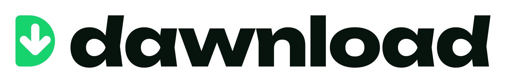
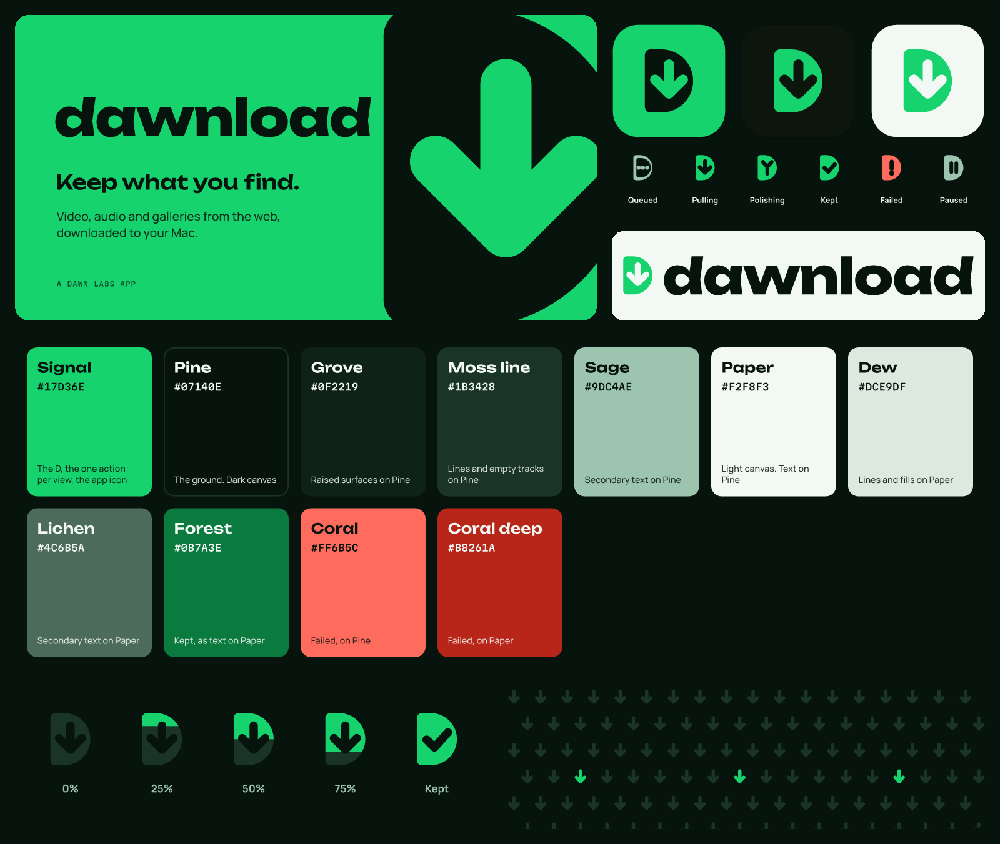
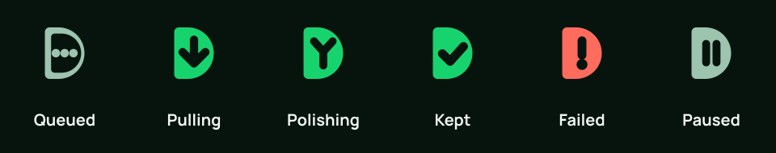
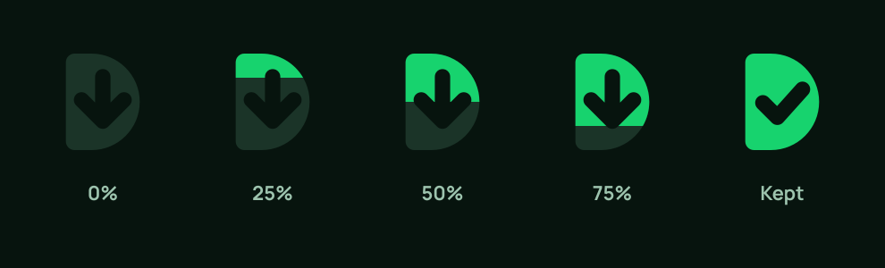
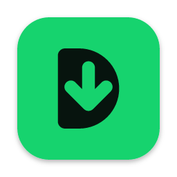
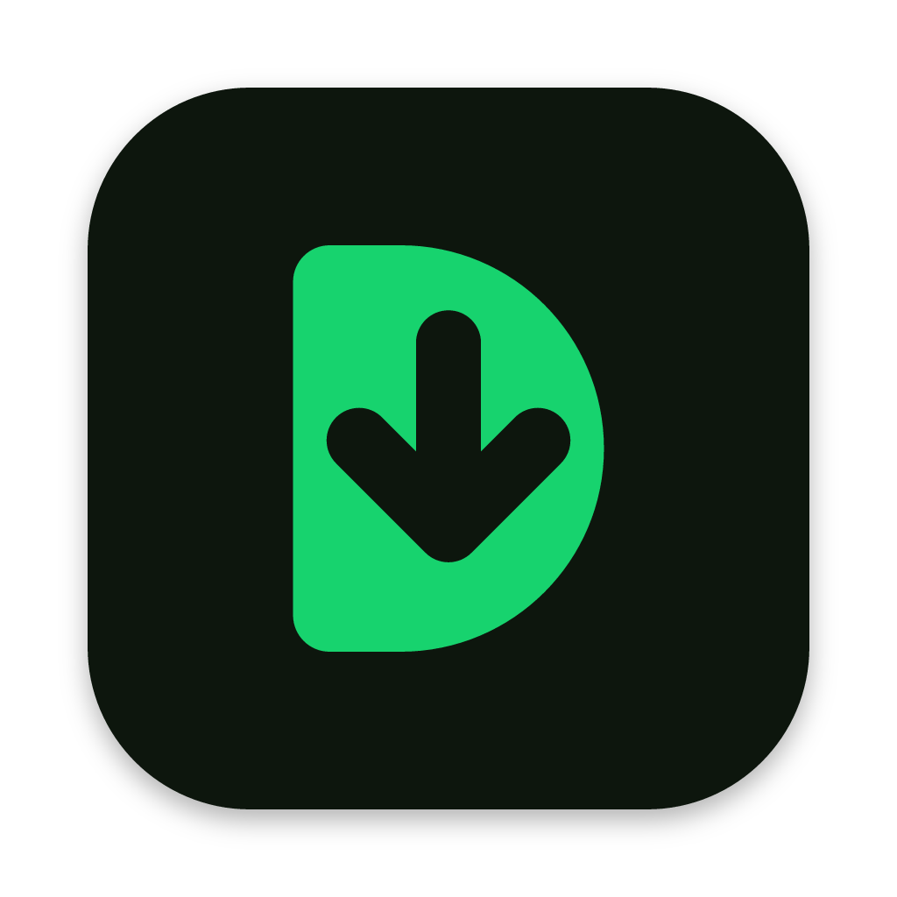

# Dawnload brand kit



**Keep what you find.** Dawnload is the Mac app that downloads video, audio and
galleries from the web onto your disk. This folder is its identity: the mark, the
app icon, the colours, type, status glyphs, patterns and tokens, all generated by
`source/build_brand.py`.



Status: drawn on 8 November 2026, not yet wired into the app. The redesign of the
app's UI builds on this kit.

## The idea

**The Cut D.** Every Dawn mark is a D: a spine joined to a half-disc. Dawnload
makes that D solid, gives it a deeper spine, and punches a download arrow
through it. It is a download button and a Dawn product in one shape, and it
reads at 16 px.

The cut is the system. The arrow says the file is coming down; swap the cut
and the same D says every other state the app has:

| State | Cut | Meaning |
| --- | --- | --- |
| Queued | three dots, D in outline | Waiting its turn; nothing has started |
| Pulling | the arrow | Downloading |
| Polishing | two strokes merging into one | ffmpeg is merging, remuxing or tagging |
| Kept | a check | Saved to disk |
| Failed | an exclamation mark | Stopped with an error |
| Paused | two bars | Held by the person |



**Progress fills the D from the top**, the way the arrow points. A full D turns
into Kept: the check replaces the arrow.



## Colourways

The kit is built twice from the same geometry. **Green is Dawnload's
colourway** (chosen 8 November 2026) and fills the root of this folder.
**Violet** is kept as an alternate in [`violet/`](violet/), with the same files
and names.

  

- **Green** is the classic download-button green, **Signal** (`#17D36E`), on
  **Pine**. One colour does every job: the mark, the action, progress and Kept,
  so hierarchy comes from size and fill rather than hue. Text on Signal is
  always Pine, never white. On Paper, **Forest** takes Signal's job for text,
  links and progress.
- **Violet (alternate)** is Dawn Media's violet (`#6622D1`) with **Volt**, an
  electric lime for progress and Kept, on Night.

### Green

| Name | Hex | Use |
| --- | --- | --- |
| Signal | `#17D36E` | The D, the action, progress and Kept. Pine on Signal is 9.5:1 |
| Pine | `#07140E` | The ground, and all text on Signal |
| Grove | `#0F2219` | Raised surfaces on Pine |
| Moss line | `#1B3428` | Lines and empty tracks on Pine |
| Sage | `#9DC4AE` | Secondary text on Pine (9.8:1) |
| Paper | `#F2F8F3` | Light canvas |
| Dew | `#DCE9DF` | Lines and fills on Paper |
| Lichen | `#4C6B5A` | Secondary text on Paper (5.5:1) |
| Forest | `#0B7A3E` | Signal as text, links and progress on Paper (5.0:1) |
| Coral / Coral deep | `#FF6B5C` / `#B8261A` | Failed, on Pine / on Paper |

### Violet (alternate)

| Name | Hex | Use |
| --- | --- | --- |
| Violet | `#6622D1` | The D, the one action per view, the app icon. Paper on Violet is 6.9:1 |
| Lilac | `#B795FF` | The D, links and focus on Night (8.2:1) |
| Volt | `#C8FF2E` | Progress and Kept on Night. The arrow's light in the dark icon |
| Night | `#0D0720` | The ground. Dark canvas |
| Dusk | `#1A0F38` | Raised surfaces on Night |
| Seam | `#2C1D55` | Lines and empty tracks on Night |
| Haze | `#B9A6E0` | Secondary text on Night (9.0:1) |
| Paper | `#F5F0FD` | Light canvas. Text on Night |
| Mist | `#E3D9F5` | Lines and fills on Paper |
| Smoke | `#5E4E86` | Secondary text on Paper (6.5:1) |
| Ink | `#1E0F3D` | Text on Paper |
| Moss | `#3E6B00` | Kept, as text on Paper (5.7:1) |
| Coral / Coral deep | `#FF6B6B` / `#C0262D` | Failed, on Night / on Paper |

Colour never carries a state alone: every state has its glyph and its word.

## Type

- **Display: Unbounded ExtraBold** (800), tracking −0.02em. The wordmark, the
  one headline a window gets, big counts. Never for running text.
- **Text: Manrope** 500 and 700 for the web and marketing. Inside the Mac app,
  interface text is **SF Pro** through Apple's text styles.
- **Mono: Martian Mono** 500 for what the machine owns: URLs, file names,
  sizes, formats, log lines from yt-dlp, gallery-dl and ffmpeg.

All three are SIL OFL. The SVGs have every word outlined, so nothing depends
on installed fonts.

## Shape and motion

- **Two radii, from the D.** The round side becomes the pill (buttons, chips,
  the paste field's button); the spine's small corner (6 px) is for fields,
  rows and cards' inner parts. Cards use 20 px.
- **The pull.** Pressing Download pushes the arrow down a few points and lets
  it spring back (260 ms). Items arriving in the queue settle in from above
  (520 ms, ease-out). The fill tracks real progress and is never faked.
- **The loader** is the arrow passing down through the D, on repeat. It is the
  only looping motion. Under Reduce Motion, show the still mark.

## Voice

Plain, short and confident. Say the specific thing.

- Verbs: **Paste, Download, Keep.** States: Queued, Pulling, Polishing, Kept,
  Failed, Paused.
- Errors say what happened and what to do: "This site refused the request
  (HTTP 403). Turn on browser impersonation, or add your cookies.txt in
  Settings."
- Done says where the file is: "Kept in Downloads. Show in Finder."
- Empty states invite the one action: "Paste a link to start."
- No hype ("blazing fast", "seamless", "unlock"), no piracy talk ("rip",
  "grab anything"), no exclamation marks in the interface, no emoji.
- Dawnload is for media you have the right to keep, and the brand says so
  wherever it talks about downloading from other people's sites.

## Using the logo

| Use | File | Smallest |
| --- | --- | --- |
| Headers, docs, the site | `logo/dawnload-lockup-colour.svg` on Paper, `-night` on Pine, `-brand` on Signal | 120 px wide |
| Square spaces, splash, About | `logo/dawnload-stacked-*.svg` | 96 px wide |
| App icon, avatar, toolbar, favicon | `logo/dawnload-mark*.svg` | 16 px |
| One colour (print, engraving, overlays) | `*-mono.svg` (`currentColor`) | as above |

- Clear space: the D's spine depth on every side.
- The arrow always points down and sits on the centre of the D's width. Never
  rotate, mirror or outline the D, and never swap the arrow for another cut in
  the logo (the other cuts are status glyphs, not logos).
- The wordmark is drawn; never type "dawnload" in a font. Lowercase, one word.
- In copy, write the name **Dawnload**.
- Volt and Signal are light: never put them behind Paper text.

## Files

| Folder | Contents |
| --- | --- |
| `logo/` | The mark (brand, Night, Paper, Ink, mono, solid), the wordmark (Ink, Paper, brand, mono), the horizontal lockup and the stacked lockup (colour, Night, brand, mono), PNG renders of the main ones |
| `app-icon/` | macOS icons on Apple's 1024 grid: default, dark, light and mono (for tinted and clear appearances); `png/` has 1024 to 16 |
| `web/` | `favicon.svg` and PNGs, touch and PWA icons, the share card (1200 × 630), banner (1500 × 500), avatar (400), and `dawnload-tokens.css` / `.json` |
| `graphics/` | Palette, construction, the status glyph sheet and `states/` (24 px, `currentColor`), the progress fill (Night and Paper), the Field pattern and its tile, the animated loader |
| `violet/` | The same tree in the Violet alternate |
| `source/` | The generator: `geo.py` (the D and its cuts), `text.py` (outlined type), `build_brand.py` |

## Rebuild

```bash
docs/brand/source/fetch_fonts.sh
python3 -m pip install -r docs/brand/source/requirements.txt
python3 docs/brand/source/build_brand.py          # both colourways
python3 docs/brand/source/build_brand.py green    # or one
```

The fonts download into `source/fonts/`, which git ignores.
